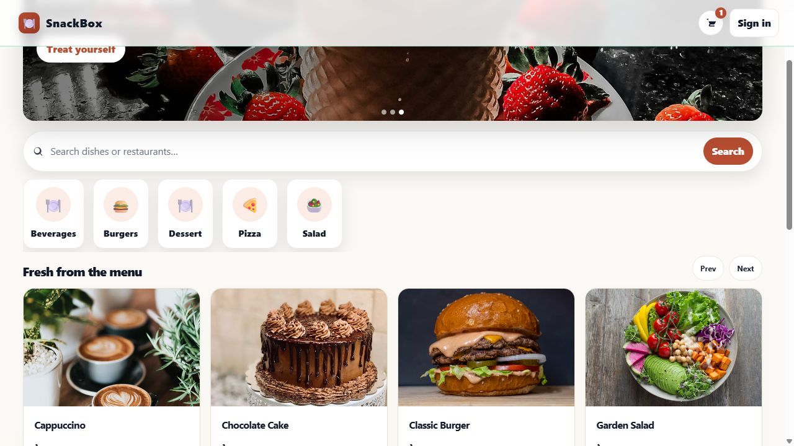

<div align="center">

# SnackBox

### Your break, made better.

A campus canteen application connecting customers, kitchen staff, inventory and administration.

[Live demo](https://snackbox.tahmidkhan.com.bd) · [Report an issue](https://github.com/tahmidkhanshuvo/SnackBox/issues)

   

</div>



Originally developed for **CSE3100** at AUST by **Tahmid Khan, Tahmid Amir, Saobia Islam Tinni, and Nusrat Jahan Mim**. SnackBox demonstrates institutional canteen operations. A demo order is an application record; this deployment does not arrange real food delivery or charge a card.

## Features

| User           | Available flows                                                                                                                                     |
| -------------- | --------------------------------------------------------------------------------------------------------------------------------------------------- |
| Visitor        | Browse the menu, search/filter real categories, view availability and prices, build a local cart                                                    |
| Customer       | Register/sign in, customize an order, preserve cart notes, place and track orders, cancel pending orders, edit a profile/avatar and submit feedback |
| Approved staff | Manage the menu, uploads, stock movements, orders, complaints, shifts and salary records                                                            |
| Administrator  | Access the administrator dashboard, review users and manage menu/orders                                                                             |

Prices and customization options are validated on the server. A caller cannot override an item's price or order an unavailable product. Customers can access only their own orders and complaints; staff APIs require an approved active staff account or an administrator. Navigation, footer help pages, catalogue pagination and guest cart browsing are included.

New menu photos and avatars are stored in the existing database, with a 2 MB upload limit. They survive restarts and redeployments on hosts with ephemeral disks. Old local-storage paths remain readable when their files are available; previously lost files cannot be recovered by a UI update. Database backups include the new media table.

## Local setup

Install **PHP 8.3**, Composer, **Node.js 22**, and PHP extensions for SQLite (or your selected database), GD, mbstring, intl and ZIP.

```sh
cd backend
composer install
cp .env.example .env
php artisan key:generate
# Create backend/database/database.sqlite if using the SQLite example.
php artisan migrate
php artisan serve --host=127.0.0.1 --port=8000
```

In a second terminal:

```sh
cd frontend
npm ci
cp .env.example .env.local
npm run dev
```

Open `http://localhost:5173`. Vite proxies local API paths to port 8000. The frontend uses Bearer tokens when `VITE_WITH_CREDENTIALS=false`, which also avoids cross-site cookie issues on the separately hosted demos.

### Initial administrator

Set `ADMIN_EMAIL` and a unique `ADMIN_PASSWORD` of at least 12 characters, clear cached configuration, then run:

```sh
php artisan config:clear
php artisan snackbox:create-admin
```

The command creates a new account only; it does not reset or promote an existing user. Keep credentials outside Git. `php artisan db:seed` supplies local demonstration data and is intentionally blocked in Production. Server startup never resets or seeds an existing database. For an empty demonstration menu, run `php artisan snackbox:seed-catalogue`; it creates five illustrative items and opening stock, and preserves any existing catalogue. Demo food photos use Unsplash URLs.

## Environment

| Variable                        | Location | Purpose                                                                      |
| ------------------------------- | -------- | ---------------------------------------------------------------------------- |
| `APP_KEY`                       | Backend  | Stable Laravel encryption key; generate once and preserve across deployments |
| `APP_ENV`, `APP_DEBUG`          | Backend  | Use `production` and `false` on hosting                                      |
| `APP_URL`                       | Backend  | Public HTTPS API origin, also used for durable image URLs                    |
| `DB_CONNECTION`                 | Backend  | `mysql`, `pgsql`, or local `sqlite`                                          |
| `DATABASE_URL` / `DB_URL`       | Backend  | Hosted connection URL; private                                               |
| `DB_SSLMODE`                    | Backend  | PostgreSQL TLS mode, default `require`                                       |
| `CORS_ALLOWED_ORIGINS`          | Backend  | Comma-separated exact frontend origins                                       |
| `FRONTEND_URL`                  | Backend  | Frontend origin fallback                                                     |
| `SESSION_*`                     | Backend  | Session settings for clients that use cookie authentication                  |
| `ADMIN_EMAIL`, `ADMIN_PASSWORD` | Backend  | Explicit first-administrator command                                         |
| `VITE_API_URL`                  | Frontend | Backend origin, **without** `/api`; empty for the local proxy                |
| `VITE_WITH_CREDENTIALS`         | Frontend | `false` selects token authentication for the demo                            |

Keep `APP_KEY`, database passwords and signing/provider credentials server-side. Vite variables are public. `.env.example` contains placeholders and local configuration only.

## Repository guide

| Path                                    | Purpose                                                             |
| --------------------------------------- | ------------------------------------------------------------------- |
| `backend/app/Http/Controllers`          | Auth, menu, orders, inventory, complaints, staff and administration |
| `backend/app/Services/MenuPricing.php`  | Authoritative customization/pricing rules                           |
| `backend/app/Services/MediaStorage.php` | Durable bounded image storage and legacy URL support                |
| `backend/app/Http/Middleware`           | Administrator and approved-staff access                             |
| `backend/database/migrations`           | Additive schema changes, including media assets                     |
| `backend/tests/Feature`                 | Ordering, authorization, pricing and upload regressions             |
| `frontend/src/pages`                    | Customer, staff, administrator and help screens                     |
| `frontend/src/api`, `context`           | API/auth client and persistent cart state                           |

## API landmarks

| Endpoint                                       | Purpose                                                       |
| ---------------------------------------------- | ------------------------------------------------------------- |
| `GET /api/healthz`                             | Database-aware readiness                                      |
| `GET /api/menu-items`, `/api/menu-categories`  | Public catalogue and actual categories                        |
| `POST /api/token-register`, `/api/token-login` | Token-based account access                                    |
| `GET /api/auth/me`, `PATCH /api/auth/me`       | Profile and avatar                                            |
| `GET` / `POST /api/orders`                     | Scoped order list and server-priced ordering                  |
| `PATCH /api/orders/{id}/status`                | Staff status changes or owner cancellation of a pending order |
| `/api/menu-items/{id}/inventory/move`          | Approved-staff stock ledger                                   |
| `/api/complaints`                              | Scoped customer feedback and authorized staff responses       |
| `GET /api/media/{uuid}`                        | Public validated image bytes with immutable caching           |
| `/api/admin/*`                                 | Administrator-only tools                                      |

## Verification

```sh
cd backend
php artisan test
php artisan route:cache
php artisan route:clear
cd ../frontend
npm run build
```

Tests use an isolated in-memory SQLite database. They cover the menu-to-order/staff workflow, server-owned prices, customization validation, unavailable-item rollback, cross-account access restrictions, and durable menu/avatar uploads after replacing the filesystem. CI runs the API suite and frontend production build.

## Deployment

The existing free Render Docker API uses root `backend`, Dockerfile `Dockerfile`, and context `.`. Set a persistent `APP_KEY`, production environment, database connection and frontend CORS origins. The entrypoint clears/caches configuration, runs **additive** migrations with retry, prepares legacy storage links, and starts the server. It never runs `migrate:fresh`, changes the encryption key, or seeds automatically.

Deploy the frontend with root `frontend`, build `npm run build`, output `dist`, and its public API origin. The included Vercel configuration forwards same-origin API requests to Render and preserves direct application URLs on refresh. Keep the old deployment for rollback. After release, verify catalogue images, sign-in, cart notes, one disposable order, scoped order history and staff access. Free Render services can take a moment to wake.

The refreshed public demo uses a new free Neon PostgreSQL database. The previous Railway MySQL database was unavailable during verification; it was not reset or deleted, and its connection was retained in ignored local recovery configuration. Historical Railway records were not migrated. The new demo catalogue and existing owner login were provisioned explicitly.

The PHP 8.3 PostgreSQL connection uses emulated prepared statements for compatibility with Neon's transaction pooler, while continuing to bind query parameters. This follows the [PgBouncer PHP/PDO guidance](https://www.pgbouncer.org/faq.html#how-to-use-prepared-statements-with-transaction-pooling). Set `DB_EMULATE_PREPARES=false` only with a compatible direct connection/client. Container logs go to stderr for hosting diagnostics; private `.env*` files and compiled local configuration are excluded from Docker builds.
